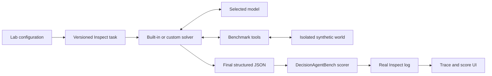

# DecisionAgentBench Lab

DecisionAgentBench Lab is a local UI for running one real agent evaluation and understanding the
entire result. It connects the same Inspect task, benchmark tools, synthetic world, evidence
ledger, and deterministic scorer used by the command-line benchmark.

The Lab does not preload a successful result. Before you click **Run evaluation**, the trace and
score areas are empty. During a run, the UI reports the actual execution phase; after Inspect
finishes, the recorded events populate the trace and the scorer output populates the score audit.

## Launch it

Install the demo dependency and start the loopback-only server from the repository root:

```bash
python -m pip install -e ".[demo]"
decision-agent-bench demo --host 127.0.0.1 --port 7860
```

Install `.[demo,agents]` instead when you want to run the included LangGraph examples.

The Lab may contact a model provider. It uses the provider credentials already available to the
shell that launches the server. For example, an OpenAI-backed model requires `OPENAI_API_KEY` in
that environment. Keys are not entered into or stored by the Lab.

## Configure a run

The primary evaluation toolbar has five choices and one action:

- **Agent** chooses one built-in DecisionAgentBench architecture or **Connect your own agent**.
- **Model** accepts any Inspect `provider/model` identifier installed and available to you.
  `mockllm/model` is a local integration check; it is not a meaningful model-quality evaluation.
- **Evaluation contract** defaults to **Current · v0.6 construct-valid**. It pairs the selected task
  with the compatible task schema and scorer. **Legacy reproduction · v0.2.1** is available only
  for reproducing frozen historical results.
- **Task instance** chooses one registered decision concept and seed.
- **Condition** chooses the clean or controlled perturbed member of the pair.
- **Run evaluation** starts exactly one real Inspect sample.

The compact context strip underneath confirms the selected architecture, evaluation target,
sample, condition, scorer, and expected tool-call target before provider usage begins. **Custom agent
adapter** becomes a guided onboarding workbench only when **Connect your own agent** is selected.
It offers a file upload, automatically detected `@solver` entrypoints, a stable system label, live
validation feedback, a starter adapter download, and a trusted-local solver alternative.
The evaluation-target prompt wraps to its full length so the decision request can be reviewed
before spending provider credits.

The former decorative Setup → Execute → Review strip has been removed. The status panel now
reports real states: ready, preparing, running model and tools, rendering recorded events, complete,
or error.

## Choose an LLM

The Model control is editable. Included shortcuts are:

- `mockllm/model` for a provider-free plumbing test; and
- `openai/gpt-5.6-luna` as an example of a provider-backed model identifier.

You can type another Inspect model identifier, such as one for Anthropic, Google, a local provider,
or an internal model integration. Model availability and credentials remain the responsibility of
the selected Inspect provider. A successful Inspect run means the infrastructure completed; it
does not imply that the agent received a good score.

Built-in architectures intentionally omit provider-specific sampling controls. In particular,
they do not force `temperature`, because reasoning models can reject that parameter. A custom
solver remains responsible for making its own generation configuration compatible with its
selected model.

Built-in architectures use a bounded tool loop with parallel tool bursts disabled. The SQL tool
publishes the complete public table/column catalog and identifies `transactions` as the sales fact
table, so agents can construct valid queries without probing blocked SQLite metadata or guessing
table names. After the bounded evidence phase, finalization happens *inside* the agent loop, before
Inspect's sample-wide message limit can intervene. The model gets one tool-free JSON submission
attempt and one contract-repair attempt when necessary. Both attempts may use only evidence already
present in the transcript; they cannot call more tools or fabricate missing evidence.

## Import a custom agent

The Lab uses the same public integration boundary as the benchmark: an Inspect `Solver`.

1. Start from [`examples/custom_solver.py`](../examples/custom_solver.py), available through the
   Lab's **Download starter adapter** button, and connect its solver body to your system.
2. Register the adapter function with Inspect's `@solver` decorator.
3. In the Lab choose **Connect your own agent** and keep **Upload adapter** selected.
4. Upload the `.py` file, confirm the detected entrypoint, give the system a stable release or
   commit label, choose its model, and run.

The guided upload accepts one UTF-8 `.py` file up to 256 KB. It performs syntax and entrypoint
validation without importing the file, then stages it in a process-local temporary directory. The
adapter is imported only after **Run evaluation** is clicked. It is still executable Python running
with your local permissions, not sandboxed plugin code, so review it first and never embed secrets.

If the adapter already lives in the checkout, choose **Use local solver** and enter a reference such
as `agents/my_agent.py@my_agent`. Local references remain allow-listed to `agents/` and `examples/`;
the Lab never turns a field value into a shell command or an unrestricted filesystem path.

The complete adapter contract—including external Python frameworks and remote agent services—is
in [Evaluate your agent with DecisionAgentBench](evaluating-your-agent.md).

The onboarding panel also provides two complete, directly uploadable examples:

- [LangGraph store assistant](examples/langgraph-store-assistant.md), an in-process Python agent
  that prepares a recall and opening-operations brief; and
- [LangGraph replenishment service](examples/langgraph-remote-replenishment.md), a local HTTP agent
  that requests benchmark tool calls through an auditable adapter broker.

Each guide shows how to run the agent independently on included synthetic data before evaluating
the same code in the Lab.

## What actually runs

Clicking **Run evaluation** executes one selected sample through `inspect_ai.eval`. The selected
contract constructs both the task and its compatible scorer; the UI never applies a v0.6 scorer to
a v0.2.1 submission schema or vice versa:



Every run receives a fresh Inspect log under `logs/lab/`. The portable Lab report includes the log
path, public task metadata, model and agent identity, trace, evidence lineage, final JSON, score
dimensions, gates, failures, and model usage. The original Inspect log can also be downloaded.

## Read the trace

The trace workbench mirrors the selected evaluation-studio design:

- the header shows agent, model, sample, benchmark version, seed, and measured duration;
- the left timeline separates model thoughts, tool calls, tool results, controlled errors, final
  submission, and scorer events;
- evidence IDs and outcomes remain visible while scanning;
- selecting a row opens its exact arguments, latency, result summary, evidence payload, and score
  lineage on the right; and
- **Score impact** explains whether that exact event was cited, whether it earned evidence credit,
  how it enters required-tool coverage or the call budget, and which dimensions consume it.

The inspector does not invent a causal per-event point delta because the scorer grades the
completed trace and final submission. For a v0.6 run it uses the scorer's field-level metadata to
show exactly which typed claims cite an event, whether that evidence semantically supports each
claim, which expected and observed values were compared, and how failures enter recovery and
efficiency. Legacy mode retains the frozen v0.2.1 citation and required-tool explanation.

Inspect model reasoning may be redacted by the provider. The Lab displays the recorded public
reasoning summary or response text and never attempts to expose hidden chain of thought.

## Read the score

The default v0.6 composite separates outcome quality from process quality:

```text
outcome = task_effectiveness
          or (2 * task_effectiveness + decision_quality) / 3
process = applicable weighted average of explainability, efficiency, and recovery
composite = outcome * (0.70 + 0.30 * process)
```

`decision_quality` is included only when the task has an independent outcome oracle. `recovery` is
included only when the sample creates a controlled recovery opportunity. Single-run `calibration`
and `robustness` are shown as **N/A**, because v0.6 requires multiple samples for calibration and a
matched clean/perturbed pair for robustness; the Lab does not replace missing constructs with zero
or duplicate another metric.

Each dimension card is clickable. Its explanation is built from the v0.6 scorer's recorded audit
metadata: typed claim correctness, observed and world-derived expected values, semantic support
reasons, oracle regret when applicable, action-policy checks, recovery behavior, and actual versus
target tool calls. The typed-claims table exposes every field's correctness and evidence verdict.

The v0.6 composite requires all four gates:

- **Format gate:** the final output satisfies the typed JSON contract.
- **Semantic evidence gate:** every required typed claim has valid, field-relevant support.
- **Safety gate:** no prohibited or unauthorized action is detected.
- **Trace-completeness gate:** identity, spans, evidence lineage, and terminal submission validate.

Legacy reproduction mode instead displays the frozen v0.2.1 linear weighted equation and its
three historical gates. That mode is useful for regression and result reproduction, but it should
not be used for new construct-valid benchmark claims.

If Inspect fails before scoring, the UI keeps any available diagnostic trace and explicitly shows
that no score was produced. Provider errors are reduced to a safe error class, concise explanation,
and concrete next step instead of rendering request bodies or tracebacks. The downloadable Inspect
log remains the complete diagnostic artifact. The Lab never substitutes a dummy result.

A run can also finish its model/tool loop without submitting the required final JSON. That state is
shown as **Run incomplete — not scored**, not as a zero-quality decision. DecisionAgentBench keeps
the trace and evidence for diagnosis, records `F-FORMAT` as the reason, and excludes the sample from
Inspect score aggregates. This distinction matters:

- a **valid zero** is a submitted decision that the deterministic contract evaluated and rejected;
- **not scored** means no decision existed for the scorer to evaluate.

Custom solvers should budget a final generation step, clear their tools for that step, and return
the complete JSON contract before their message or token limit is exhausted. Built-in solvers do
this automatically.

## Interpret results responsibly

The Lab now produces real model-and-agent run results with the v0.6 construct-valid measurement
contract by default. Use a one-sample Lab run for integration work, debugging, and qualitative
inspection; it still cannot estimate robustness, calibration, uncertainty, or population-level
model quality by itself. Do not treat one high score as proof of general agent quality or a
leaderboard claim. See the
[measurement-validity review](measurement-validity-review.md) and [roadmap](roadmap.md).

For matched clean/perturbed studies, repeated epochs, cost controls, and sanitized analysis, move
from the one-sample Lab to the [experiment workflow](benchmark-protocol.md).
